<div align="center">

# ⚖️ KARMA LEDGER
### *Normalize the Universe • From Chaos to Divine Integrity*

[](https://react.dev/)
[](https://www.typescriptlang.org/)
[](https://vitejs.dev/)
[](LICENSE)
[](#-the-normalization-journey)

<p align="center">
  <b>Where Ancient Indian Cosmology Meets Modern Relational Database Theory.</b><br>
  An interactive, gamified, and cinematic journey teaching Database Normalization through the court of Yamraj, Chitragupta's cosmic ledger, Sage Bhrigu's observatory, and Sage Narada's divine investigations.
</p>

[Explore The Live Demo](#-getting-started) • [Report Bug](https://github.com/yash12345-ctrl/Karma-Ledger/issues) • [Request Feature](https://github.com/yash12345-ctrl/Karma-Ledger/issues)

---

</div>

## 🌌 The Legend Behind the Database

In **Yamaloka**, the celestial realm of reckoning, **Chitragupta** records every deed committed by mortal souls into the sacred `KARMA_LEDGER`. But as the centuries passed and mortal sins diversified, the cosmic database began experiencing catastrophic bottlenecks:

- Multi-valued deed arrays crashed the judgment queries!
- Redundant soul records led to horrific deletion anomalies!
- Transitive karma rules forced millions of rows to be updated for a single decree!
- Overlapping court assignments created phantom data loss!

Witness how **Lord Yamraj**, **Chitragupta**, **Sage Bhrigu**, and **Sage Narada** systematically purify the divine database through **1NF, 2NF, 3NF, and BCNF**!

---

## 📜 The Normalization Journey

```mermaid
flowchart LR
    UNF[Raw Ledger: Unnormalized] -->|Atomicity| NF1[1NF: Chitragupta]
    NF1 -->|Remove Partial Dependencies| NF2[2NF: Yamraj's Court]
    NF2 -->|Remove Transitive Dependencies| NF3[3NF: Sage Bhrigu]
    NF3 -->|Every Determinant a Superkey| BCNF[BCNF: Sage Narada]
    BCNF -.->|Multi-Valued Dependencies| NF4[4NF: Sage Vyasa Preview]
```



---

### 🏛️ Interactive Chapters

### 1️⃣ Chapter 1: Chitragupta's Record Room (1NF)
> *"First Normal Form dictates: Every cell must hold an atomic, indivisible value!"*

- **The Crisis:** Soul records cram multiple deeds into comma-separated arrays (e.g., `"Theft, Lying, Cheating"`).
- **The Transformation:** Chitragupta atomizes each array element into distinct rows with composite primary keys.
- **Interactive Mini-Game:** Repair the torn celestial scroll by extracting comma-separated deeds and validating atomic row placement.

---

### 2️⃣ Chapter 2: Yamraj's Court of Partial Dependencies (2NF)
> *"No non-prime attribute shall depend on only part of a composite primary key!"*

- **The Crisis:** Composite key `(SoulID, DeedNo)` determines the deed, but `SoulName` and `BirthCity` depend *only* on `SoulID`.
- **The Anomaly:** When soul Rohan's only deed is expunged, deleting the deed row deletes Rohan from the mortal records entirely (**Deletion Anomaly**)!
- **The Transformation:** Yamraj strikes his divine staff, cleaving the table into:
  - `SOUL` (`SoulID` 🔑, `SoulName`, `BirthCity`)
  - `DEED` (`SoulID` 🔑, `DeedNo` 🔑, `KarmaType`)

---

### 3️⃣ Chapter 3: Sage Bhrigu's Celestial Observatory (3NF)
> *"A non-key attribute must never determine another non-key attribute!"*

- **The Crisis:** `(SoulID, DeedNo) ➔ KarmaType`, but `KarmaType ➔ (DeedNature, Consequence, Realm)`.
- **The Anomaly:**
  - **Repetition Curse & Update Anomaly:** `Hot-sand walk, 7 days` is duplicated across millions of rows.
  - **Insertion Anomaly:** A new sin like *Cruelty* cannot be registered without creating a fake deed by a fake soul!
- **The Transformation:** Sage Bhrigu points his cosmic armillary sphere and extracts universal rules into a separate golden tablet:
  - `KARMA_RULE` (`KarmaType` 🔑, `DeedNature`, `Consequence`, `Realm`)
  - `DEED` retains only `KarmaType` as a Foreign Key.

---

### 4️⃣ Chapter 4: Sage Narada & The Unqualified Judge (BCNF)
> *"Boyce-Codd Normal Form: In every non-trivial functional dependency X ➔ Y, X MUST be a Superkey!"*

- **The Crisis:** In `COURT_ASSIGNMENT (SoulID, Court, Judge)`, candidate keys are `(SoulID, Court)` and `(SoulID, Judge)`. Each judge serves in only one court (`Judge ➔ Court`).
- **The 3NF Loophole:** The table satisfies 3NF because `Court` is a **Prime Attribute**. But `Judge` is **NOT A SUPERKEY**!
- **The Anomaly:** Deleting soul S101 completely erases the record that *Dana Court* exists with *Judge Ila*.
- **The Transformation:** Sage Narada strums his veena, decomposing the table into:
  - `JUDGE` (`Judge` 🔑, `Court`)
  - `SOUL_JUDGE` (`SoulID` 🔑, `Judge` 🔗)
- **Interactive Investigator Quiz:** Test your knowledge on determinants, candidate superkeys, and BCNF proofs.

---

### 5️⃣ Chapter 5: Sage Vyasa & Infinite Combinations (4NF)
> *"Fourth Normal Form: No table shall contain two or more independent multivalued facts!"*

- **The Crisis:** In `TABLE C (SoulID, Language, Skill)`, a soul's languages and skills are completely independent multivalued dependencies (`SoulID ↠ Language` and `SoulID ↠ Skill`).
- **The Combinatorial Explosion:** Storing independent attributes together forces a massive Cartesian cross-product (`3 languages × 4 skills = 12 rows`). Adding 1 language forces multiple duplicate rows!
- **The Transformation:** Sage Vyasa raises his sacred manuscript, dissolving the cross-product links into golden particles and cleaving the table into:
  - `SOUL_LANGUAGE` (`SoulID` 🔑, `Language` 🔑) — 3 rows
  - `SOUL_SKILL` (`SoulID` 🔑, `Skill` 🔑) — 4 rows
  - Storing 3 + 4 = 7 rows instead of 12 rows!
- **Interactive Sages Challenge:** Drag and sort unassigned languages and skills into their independent relation tables.
- **The Grand Finale Ceremony:** Chitragupta's sacred scroll transforms into a radiant golden ledger, celebrating all 5 Normal Forms completed!

---

## ✨ Design & Visual Excellence

- **Cosmic Celestial Aesthetic:** Designed with deep twilight palettes (`#050716`), gilded accents (`#f7c566`), breathing nebulae, and armillary rings.
- **Zero Style Leakage:** Scoped CSS architecture guaranteeing that animations, dialog banners, and interactive game arenas remain isolated and modular.
- **Procedural Sound Engine:** Powered by the browser's Web Audio API generating synthesised chimes, slicing waves, staff-strike shockwaves, and victory chords without external heavy MP3s.
- **Liquid Responsiveness:** Custom layouts scaling from 4K cinema displays down to mobile smartphones.

---

## 🛠️ Tech Stack & Architecture

| Layer | Technology |
|---|---|
| **Core Framework** | [React 19](https://react.dev/) + [TypeScript](https://www.typescriptlang.org/) |
| **Bundler & Dev Server** | [Vite 6.0](https://vitejs.dev/) |
| **Styling** | Vanilla CSS3 (Custom Design Tokens, Glassmorphism, CSS Grid & Flexbox) |
| **Audio Engine** | Web Audio API Oscillator & Gain Synthesizers |
| **Icons & Art** | Custom SVG Glyphs + Mythology Art Engine |

---

## 📂 Project Structure

```text
yamraj_website/
├── public/                     # Static assets & audio fallback files
├── src/
│   ├── assets/                 # High-resolution mythological character art
│   │   ├── 1nf.jpg             # Sage Agastya & Chitragupta
│   │   ├── 2nf.jpg             # Lord Yamraj & Staff
│   │   ├── 3nf.jpg             # Sage Bhrigu's Observatory
│   │   ├── bcnf.jpg            # Sage Narada & Veena
│   │   └── 4nf.jpg             # Sage Vyasa Library
│   ├── components/             # Modular interactive page components
│   │   ├── Intro.tsx           # Cinematic cold-open introduction
│   │   ├── Navbar.tsx          # Sticky glassmorphic navigation bar
│   │   ├── Hero.tsx            # Main hero landing section
│   │   ├── Journey.tsx         # The interactive timeline stepper
│   │   ├── OneNFPage.tsx       # 1NF chapter & scroll repair game
│   │   ├── TwoNFPage.tsx       # 2NF court & table splitting simulator
│   │   ├── ThreeNFPage.tsx     # 3NF observatory & transitive ray tracer
│   │   ├── BCNFPage.tsx        # BCNF courtroom & balance scale quiz
│   │   ├── FourNFPage.tsx      # 4NF library & cross-product separation
│   │   └── Icons.tsx           # Custom SVGs (Scroll, Scale, Staff, Veena)
│   ├── data/                   # Data layers and simulation models
│   │   ├── journey.ts          # Normalization roadmap metadata
│   │   ├── oneNFData.ts        # 1NF table rows & challenge cards
│   │   ├── twoNFData.ts        # 2NF partial dependency records
│   │   ├── threeNFData.ts      # 3NF transitive dependency records
│   │   ├── bcnfData.ts         # BCNF court assignments & anomaly records
│   │   └── fourNFData.ts       # 4NF multi-valued dependency models
│   ├── utils/
│   │   └── soundEffects.ts     # Web Audio API divine sound synthesizers
│   ├── App.tsx                 # Route coordinator & hash listener
│   └── main.tsx                # React entry point
└── package.json
```

---

## 🚀 Getting Started

### Prerequisites
- **Node.js**: `v18.0.0` or higher
- **npm** or **yarn** or **pnpm**

### Installation

1. **Clone the repository:**
   ```bash
   git clone https://github.com/yash12345-ctrl/Karma-Ledger.git
   cd Karma-Ledger
   ```

2. **Install dependencies:**
   ```bash
   npm install
   ```

3. **Start the development server:**
   ```bash
   npm run dev
   ```

4. **Open in your browser:**
   Navigate to `http://localhost:5173/` to witness the cinematic intro, or jump directly to any normal form:
   - `http://localhost:5173/#1nf` — 1NF Chapter
   - `http://localhost:5173/#2nf` — 2NF Court
   - `http://localhost:5173/#3nf` — 3NF Observatory
   - `http://localhost:5173/#bcnf` — BCNF Investigation

### Build for Production

```bash
npm run build
npm run preview
```

---

## 🤝 Contributing

Contributions, issues, and feature requests are welcome!
Feel free to check the [issues page](https://github.com/yash12345-ctrl/Karma-Ledger/issues).

1. Fork the Project
2. Create your Feature Branch (`git checkout -b feature/DivineFeature`)
3. Commit your Changes (`git commit -m 'Add some DivineFeature'`)
4. Push to the Branch (`git push origin feature/DivineFeature`)
5. Open a Pull Request

---

## 📜 License

Distributed under the **MIT License**. See `LICENSE` for more information.

---

<div align="center">
  <b>Built with devotion and precision by <a href="https://github.com/yash12345-ctrl">Yash Tomar</a></b><br>
  <i>"May your tables forever remain atomic, lossless, and anomaly-free."</i>
</div>
